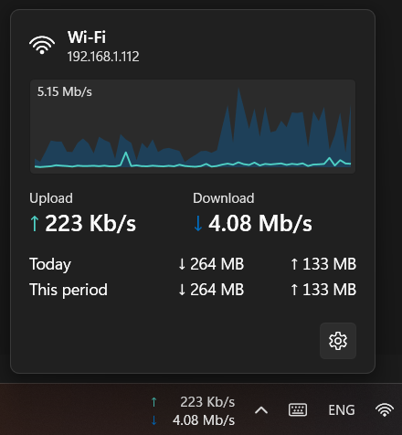

# NetStrip

A minimal Windows network speed monitor. NetStrip shows live upload and download speeds inline on the taskbar, next to the system tray, with a Fluent flyout for details and daily and monthly usage totals.



## Features

- Upload and download speeds on the taskbar, updated every second, without making the taskbar jitter.
- Flyout with current speeds and daily and monthly usage totals.
- Light and dark theme aware, with system colors for high-contrast themes.
- Survives Explorer restarts, DPI changes, theme changes, taskbar alignment changes, and auto-hide.
- Optional start with Windows. Hides while a fullscreen app is running (on by default).
- Per-user install. No administrator rights needed to install or run.

## Requirements

- Windows 10 22H2 or Windows 11, x64 or arm64.
- The installer needs the .NET 10 Desktop Runtime. The installer downloads and installs it if it is missing. The portable builds are self-contained and need nothing else.

## Install

Download the latest build from the [Releases page](https://github.com/tarek0m/NetStrip/releases).

- `NetStrip-<version>-setup-x64.exe`: per-user installer. It installs to `%LocalAppData%\Programs\NetStrip`, adds an optional "Start with Windows" setting, and uninstalls cleanly, including the startup entry.
- `NetStrip-<version>-portable-x64.zip` and `NetStrip-<version>-portable-arm64.zip`: single-file, self-contained `NetStrip.exe`. Extract and run. On an Arm64 PC, use the arm64 zip: the installer is x64 only.

### SmartScreen warning

v1 builds are not code-signed, so Windows SmartScreen may show "Windows protected your PC". Click **More info**, then **Run anyway**. For the portable zip, you can also right-click the downloaded file, open **Properties**, tick **Unblock**, and click **OK** before extracting it.

## Build from source

You need the .NET 10 SDK (the version is pinned in `global.json`) on Windows.

```powershell
dotnet build
dotnet test
dotnet run --project src/NetStrip
```

Projects:

- `src/NetStrip`: WPF app (taskbar strip, flyout, settings, startup).
- `src/NetStrip.Core`: sampling, usage tracking, formatting, settings, and update check. No WPF or Win32 dependency.
- `src/NetStrip.Shell`: taskbar host, fullscreen detection, and Win32 interop.
- `tests/NetStrip.Core.Tests`: xUnit tests.
- `installer/netstrip.iss`: Inno Setup script for the installer.

## Releases

Push an annotated `vMAJOR.MINOR.PATCH` tag. The annotation becomes the release notes. GitHub Actions runs the tests, builds the installer and portable zips, and attaches them to a new release. Tags with a `-` suffix are published as pre-releases.

```powershell
git tag -a v0.1.0 -m "First release: ..."
git push origin v0.1.0
```

To try the pipeline without publishing anything, run the **Release** workflow by hand (Actions → Release → Run workflow). It builds the same installer and zips, versioned `0.0.0-dev.<run>`, and attaches them to the workflow run as an artifact instead of creating a release.

The manual test checklist for each release is in [docs/manual-test-checklist.md](docs/manual-test-checklist.md).

## License

MIT. See [LICENSE](LICENSE).
